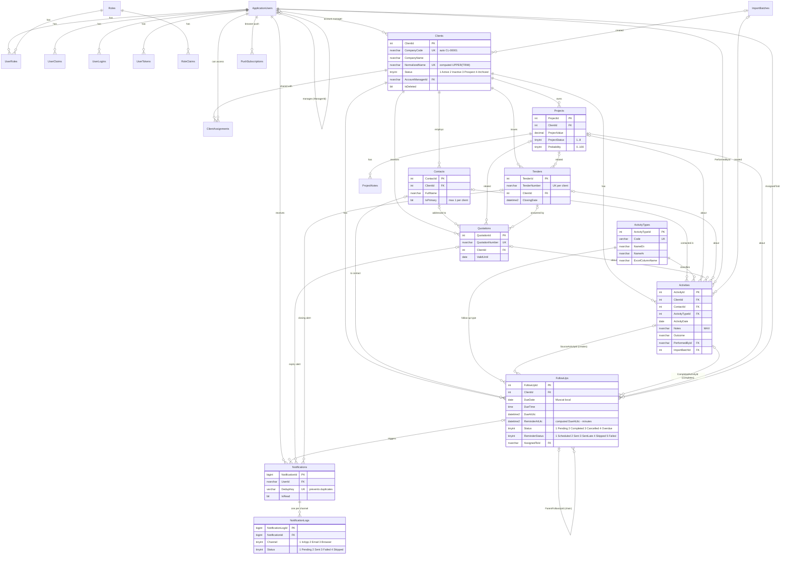

# المرحلة الأولى — تحليل المتطلبات وتصميم قاعدة البيانات (CRMDatabase)

> الحالة: ✅ مكتملة ومختبرة على SQL Server 2022 — 38/38 اختبار ناجح.

---

## 1. تحليل المتطلبات (ملخص القرارات)

| الموضوع | القرار | السبب |
|---|---|---|
| الإصدار | **.NET 10 (LTS)** | .NET 8 ينتهي دعمه في 10 نوفمبر 2026. الإصداران مثبتان على جهازك، و.NET 10 هو الإصدار المستقر طويل الدعم. |
| مصدر المخطط | **SQL Scripts هي المرجع**، وEF Core يُربط بالجداول الموجودة (بدون Migrations) | أنت طلبت Scripts صريحة، وهذا يعطي تحكماً كاملاً بالفهارس والقيود. |
| المهام المجدولة | **BackgroundService** وليس Hangfire | حالة التذكير محفوظة في الجداول نفسها (`ReminderStatus`, `ReminderAtUtc`) فيستمر العمل بعد إعادة التشغيل دون مكتبة إضافية أو جداول Hangfire. |
| أنواع الأنشطة | علاقة **One-to-Many** (`Activities.ActivityTypeId`) | المطلوب أن تُحفظ كل عملية تواصل كسجل مستقل، فصف Excel الذي فيه Call + Email يتحول إلى نشاطين، ولا حاجة لجدول ربط متعدد. |
| الحالات | `TINYINT` + `CHECK` تقابلها Enums في C# | أبسط وأسرع، وتأتي الترجمة EN/AR من ملفات `.resx`. |
| أنواع الأنشطة | جدول Lookup ثنائي اللغة (`NameEn` / `NameAr`) | يستطيع المدير إضافة أنواع جديدة دون تعديل الكود. |
| الوقت | التواريخ التقنية بتوقيت **UTC**، والتواريخ التي يكتبها المستخدم بتوقيت **مسقط** | انظر القسم 5. |
| العملة | `DECIMAL(18,3)` والعملة الافتراضية `OMR` | الريال العماني يُقسم إلى 1000 بيسة. |
| الترتيب | `Arabic_100_CI_AS` | فرز صحيح للأسماء العربية، ومقارنة الإنجليزية دون حساسية لحالة الأحرف. |
| الحذف | **Soft Delete** للشركات والأشخاص والأنشطة والمتابعات والمشاريع والعروض والمناقصات | لا يضيع السجل التاريخي أبداً. |
| التزامن | عمود `ROWVERSION` في الجداول الرئيسية | يمنع أن يمسح تعديلُ مستخدمٍ تعديلَ مستخدمٍ آخر على السجل نفسه. |

---

## 2. مخطط ERD

> يُعرض المخطط في VS Code عبر إضافة *Markdown Preview Mermaid Support*، وعلى GitHub مباشرة.



---

## 3. الجداول (24 جدولاً)

| # | الجدول | الغرض |
|---|---|---|
| 1 | `Clients` | الشركات |
| 2 | `ClientAssignments` | الشركات المسموح بها لكل موظف (Many-to-Many) |
| 3 | `Contacts` | الأشخاص داخل كل شركة |
| 4 | `ActivityTypes` | الأنواع التسعة للأنشطة (عربي/إنجليزي، أيقونة، لون، اسم عمود Excel) |
| 5 | `Activities` | سجل التواصل، وهو البديل المباشر لملف Excel |
| 6 | `FollowUps` | المتابعات القادمة ومحرّك التذكير |
| 7 | `Projects` | المشاريع والفرص التجارية |
| 8 | `ProjectNotes` | ملاحظات المشروع |
| 9 | `Quotations` | عروض الأسعار |
| 10 | `Tenders` | المناقصات |
| 11 | `Notifications` | تنبيهات الجرس، وهي مصدر قنوات البريد والمتصفح |
| 12 | `NotificationLogs` | سجل الإرسال لكل قناة: الحالة والوقت والمحاولات والخطأ |
| 13 | `PushSubscriptions` | اشتراكات إشعارات المتصفح (Web Push) |
| 14 | `ImportBatches` | سجل كل عملية استيراد Excel |
| 15 | `SystemSettings` | إعدادات النظام (Key/Value)، والأسرار فيها مشفرة |
| 16 | `AuditLogs` | سجل العمليات المهمة (القيم القديمة والجديدة بصيغة JSON) |
| 17 | `ApplicationUsers` | المستخدمون (Identity + حقول CRM) |
| 18 | `Roles` | الأدوار: Admin و SalesManager و SalesEmployee |
| 19–23 | `UserRoles`, `UserClaims`, `UserLogins`, `UserTokens`, `RoleClaims` | جداول Identity القياسية |
| 24 | `DataProtectionKeys` | مفاتيح التشفير، حتى تبقى كلمة مرور SMTP والجلسات صالحة بعد إعادة تشغيل IIS |

### الـ Views

| View | الاستخدام |
|---|---|
| `vw_ClientSummary` | جدول الشركات: آخر تواصل، المتابعة القادمة، الشخص الأساسي، عدد المتأخرات والمشاريع المفتوحة |
| `vw_ActivityDetails` | جدول الأنشطة والتقارير، مع الأسماء جاهزة |
| `vw_FollowUpDetails` | شاشة المتابعات مع `EffectiveStatus` (تصبح المتابعة متأخرة فوراً عند تجاوز موعدها) وبيانات النشاط السابق |
| `vw_ClientTimeline` | الـ Timeline في ملف الشركة: الأنشطة والمتابعات والمشاريع والعروض والمناقصات في قائمة واحدة |

---

## 4. العلاقات وسياسة الحذف

| العلاقة | النوع | عند الحذف |
|---|---|---|
| Clients → Contacts / Activities / FollowUps / Projects / Quotations / Tenders | 1 : N | **NO ACTION**: يُمنع الحذف الفعلي لشركة لها تاريخ، ويُستخدم Soft Delete |
| Clients → ClientAssignments | 1 : N | CASCADE |
| Projects → ProjectNotes | 1 : N | CASCADE |
| Notifications → NotificationLogs | 1 : N | CASCADE |
| Users → UserRoles / Claims / Logins / Tokens / PushSubscriptions | 1 : N | CASCADE (معيار Identity) |
| Activities → FollowUps (`SourceActivityId`) | 1 : N | NO ACTION: النشاط الذي أنشأ المتابعة |
| Activities → FollowUps (`CompletedActivityId`) | 1 : N | NO ACTION: النشاط المسجل عند إتمام المتابعة |
| FollowUps → FollowUps (`ParentFollowUpId`) | Self | سلسلة متابعات: إتمام ← نشاط ← متابعة جديدة |
| Users → Users (`ManagerId`) | Self | مدير المبيعات ← موظفوه |
| Clients ↔ Users (`ClientAssignments`) | M : N | الشركات المسموح بها للموظف |

> لا توجد علاقة دائرية بين `Activities` و `FollowUps`، لأن `FollowUps` وحده يشير إلى `Activities`.

---

## 5. الوقت والمنطقة الزمنية (Asia/Muscat)

- أعمدة `CreatedAt` و `UpdatedAt` و `*AtUtc` بتوقيت **UTC**.
- أعمدة `ActivityDate` و `DueDate` و `DueTime` و `SubmissionDate` بالتوقيت **المحلي لمسقط** كما يكتبه المستخدم، فيبقى تاريخ Excel الأصلي كما هو.
- يحسب التطبيق `FollowUps.DueAtUtc` من `DueDate + DueTime + TimeZoneId` باستخدام `TimeZoneInfo("Asia/Muscat")`.
- `ReminderAtUtc` عمود محسوب **PERSISTED** قيمته `DueAtUtc − ReminderMinutesBefore`، والقيمة الافتراضية 1440 دقيقة (24 ساعة).

**مثالك:** متابعة يوم 15/11/2026 الساعة 10:00 بتوقيت مسقط:
`DueAtUtc = 2026-11-15 06:00` ← `ReminderAtUtc = 2026-11-14 06:00 UTC` = **14/11/2026 الساعة 10:00 بتوقيت مسقط** ✅ (تم التحقق في الاختبار 15).

---

## 6. كيف تحقق قاعدة البيانات شروط التنبيهات العشرة

| الشرط | التنفيذ |
|---|---|
| 1. BackgroundService | المرحلة الخامسة، ويقرأ من الفهرس `IX_FollowUps_ReminderScan` |
| 2. فحص دوري | الإعداد `Reminders.ScanIntervalSeconds` (افتراضياً 60 ثانية) |
| 3. قبل 24 ساعة بالضبط | `ReminderAtUtc` محسوب في قاعدة البيانات |
| 4. عدم التكرار | `ReminderStatus` + **UNIQUE `Notifications.DedupKey`** + **UNIQUE (`NotificationId`, `Channel`)**، فحتى لو عمل خادمان معاً ترفض قاعدة البيانات التكرار |
| 5–6. لا تنبيه للمتابعة الملغاة أو المكتملة | شرط الفحص `Status IN (1,4)` |
| 7. إعادة الجدولة | `ReminderAtUtc` يُعاد حسابه تلقائياً، و `DedupKey` يحتوي وقت الموعد فيُسمح بتنبيه جديد للموعد الجديد فقط |
| 8. متابعة تُنشأ قبل أقل من 24 ساعة من موعدها | `ReminderStatus = 3 (SentLate)` + نوع التنبيه `FollowUpLateReminder` + إرسال فوري |
| 9. سجل التنبيهات | `Notifications` + `NotificationLogs` |
| 10. توقيت مسقط | القسم 5 |

صيغة `DedupKey`:
```
FU-REMIND:{FollowUpId}:{DueAtUtc yyyyMMddHHmm}:{UserId}
QT-EXPIRY:{QuotationId}:{ValidUntil yyyyMMdd}:{UserId}
TD-CLOSE:{TenderId}:{ClosingDate yyyyMMddHHmm}:{UserId}
```

---

## 7. سياسة منع تكرار الشركات

1. **`CompanyCode`** فريد بين الشركات غير المحذوفة، ويُولَّد تلقائياً (`CL-00001`) من `Seq_ClientCode`، ويمكن إدخاله يدوياً.
2. **`CompanyName`** فريد عبر العمود المحسوب `NormalizedName = UPPER(TRIM(name))` مع ترتيب غير حساس لحالة الأحرف، فتُعتبر `OQ BI` و `oq bi` و ` OQ BI ` شركة واحدة. التطبيق يدمج المسافات المتكررة أيضاً قبل الحفظ.
3. الشركة **المؤرشفة** (Status = Archived) تبقى تمنع التكرار، ولا يتحرر الاسم إلا بالحذف (Soft Delete).
4. استيراد Excel يبحث عن الشركة بـ `NormalizedName`، فإن وجدها يربط الأنشطة بها، وإلا ينشئها.

---

## 8. استيراد Excel — جاهزية قاعدة البيانات

| عمود Excel | يتحول إلى |
|---|---|
| Date | `Activities.ActivityDate` (التاريخ الأصلي كما هو) |
| Client | `Clients` (بحث بـ `NormalizedName` أو إنشاء جديد، `Source = 2`) |
| Cold Calls = 1 | نشاط مستقل `ActivityTypeId = 1` |
| Emails = 1 | نشاط مستقل `ActivityTypeId = 2` |
| Visit = 1 | نشاط مستقل `ActivityTypeId = 3` |
| Facility Tour = 1 | نشاط مستقل `ActivityTypeId = 4` |
| Note | `Activities.Notes` بنوع `NVARCHAR(MAX)` دون قص (تم اختبار 13,000 حرف) |

كل نشاط مستورد يحمل `ImportBatchId` و `SourceRowNumber` للتتبع، و `FileHash` يحذّر إذا رُفع الملف نفسه مرتين.

---

## 9. الملفات وطريقة التشغيل

```
mohammedproject/
├── Database/
│   ├── 01_CreateDatabase.sql      إنشاء CRMDatabase (لا يحذف شيئاً)
│   ├── 02_IdentityTables.sql      المستخدمون والأدوار (متوافق مع ASP.NET Identity)
│   ├── 03_CoreTables.sql          جداول CRM + PK/FK/UK/CHECK/DEFAULT + الفهارس
│   ├── 04_Views.sql               الـ Views (يمكن إعادة تشغيله)
│   ├── 05_SeedData.sql            الأدوار + أنواع الأنشطة + الإعدادات (دون بيانات وهمية)
│   ├── 06_TestRelationships.sql   38 اختباراً داخل Transaction مع ROLLBACK
│   └── RunAll.ps1                 تشغيل الكل بالترتيب
└── docs/
    └── Phase1_Database_Design.md  هذا الملف
```

**التشغيل:**
```powershell
cd C:\Users\khali\OneDrive\Desktop\mohammedproject
powershell -ExecutionPolicy Bypass -File .\Database\RunAll.ps1
# على خادم آخر:  -Server ".\SQLEXPRESS"     بدون الاختبارات:  -SkipTests
```
أو من SSMS: افتح الملفات من 01 إلى 06 بالترتيب واضغط Execute لكل ملف.

تشغيل الملفات مرة ثانية آمن: الملفان 02 و 03 يتوقفان إذا كانت الجداول موجودة، والملفان 04 و 05 يحدّثان أو يضيفان فقط ما ينقص.

**ملاحظات:**
- مستخدم Admin الأول يُنشأ من التطبيق في المرحلة الثانية، لأن Identity هو من يشفّر كلمة المرور. لا توجد كلمة مرور في أي Script.
- تحذيرات "maximum key length 900 bytes" التي تظهر عند الإنشاء طبيعية في Identity، لأن المعرّفات من نوع GUID طولها 36 حرفاً فقط.

---

## 10. ملاحظة للمرحلة الثالثة — واجهة زجاجية بأسلوب Apple

- **المادة:** Glassmorphism باستخدام `backdrop-filter: blur() saturate()` وطبقات شفافة، مع وضع فاتح وداكن.
- **الخطوط:** خط النظام `-apple-system` / SF Pro على أجهزة Apple، و **IBM Plex Sans Arabic** للعربية على باقي الأجهزة.
- **الأيقونات:** رموز SF Symbols الأصلية من Apple **لا يُسمح ترخيصها باستخدامها في مواقع الويب**، لذلك سنستخدم **Framework7 Icons**، وهي مجموعة مجانية (MIT) مصممة بنفس أسلوب أيقونات iOS. أسماء الأيقونات محفوظة في `ActivityTypes.IconName`.
- **الألوان:** ألوان نظام Apple (`#007AFF` أزرق، `#34C759` أخضر، `#FF9500` برتقالي...) وهي محفوظة في `ActivityTypes.ColorHex`.
- **الاتجاه:** RTL/LTR كامل عبر `dir` و Bootstrap 5 RTL.
